### R Markdown

This R Markdown document is made to support the findings of the paper "A screening of tools to differentiate wild vs. farmed sea cucumbers in multi-trophic aquaculture systems" by David et al. (2027).

Preparing the toolbox
---------------------

Let's begin by loading the libraries that we will require to run the analyses.

``` r
#library(agricolae)
library(vegan)
library(ade4)
library(factoextra)
library(easyCODA)
library(pls)
library(rpart)
library(ropls)
```

Loading the data
----------------

We load fatty acids, stable isotopes, amino acids and sterols data from the GitHub server.

For details on line and column headings please check the readme file.

``` r
FA <- read.csv("https://raw.githubusercontent.com/DAVID-Fk/Sea-cucumber-authenticity/main/FA_screening.csv", sep=";", header=T)
FA <- read.csv("FA_screening.csv", sep=";", header=T)
SI <- read.csv("https://raw.githubusercontent.com/DAVID-Fk/Sea-cucumber-authenticity/main/SI_screening.csv", sep=";", header=T)
AA <- read.csv("https://raw.githubusercontent.com/DAVID-Fk/Sea-cucumber-authenticity/main/AA_screening.csv", sep=";", header=T)
AA <- read.csv("AA_screening.csv", sep=";", header=T)
St <- read.csv("https://raw.githubusercontent.com/DAVID-Fk/Sea-cucumber-authenticity/main/St_screening.csv", sep=";", header=T)
St <- read.csv("St_screening.csv", sep=";", header=T)
```

Fatty acids
-----------

``` r
allFA=FA[,-c(1:8, which(colnames(FA)=="C23.0"))]
rownames(allFA)=FA[,1]
allFA[is.na(allFA)]=0

## Calculate fresh weights of batches

avg=tapply(FA$IdWeight, FA$SplBatch, mean, na.rm=T)
sd=tapply(FA$IdWeight, FA$SplBatch, sd, na.rm=T)
  
## Percentage table
prct=allFA/rowSums(allFA)*100

## Concentrations table 
conc=allFA/FA[,which(colnames(FA)=="C23.0")]*FA[,which(colnames(FA)=="StdC23")]/FA[,which(colnames(FA)=="SplMass")]
conctot=rowSums(conc)

# Let's define categories of FA

brFA=rowSums(prct[, c(which(colnames(prct)=="C15.0iso"), which(colnames(prct)=="C15.0anteiso"), which(colnames(prct)=="C16.0iso"))])
SFA=rowSums(prct[, c(which(colnames(prct)=="C14.0"), which(colnames(prct)=="C15.0"), which(colnames(prct)=="C16.0"), which(colnames(prct)=="C18.0"), which(colnames(prct)=="C19.0"),which(colnames(prct)=="C20.0"), which(colnames(prct)=="C21.0"), which(colnames(prct)=="C22.0"))])
PUFA=rowSums(prct[, c(which(colnames(prct)=="C18.2w6"), which(colnames(prct)=="C18.3w3"), which(colnames(prct)=="C18.4w3"), which(colnames(prct)=="C20.2w6"), which(colnames(prct)=="C20.4w6"), which(colnames(prct)=="C20.5w3"), which(colnames(prct)=="C22.5w6"), which(colnames(prct)=="C22.6w3"))])
HUFA=rowSums(prct[, c(which(colnames(prct)=="C20.4w6"), which(colnames(prct)=="C20.3w6"), which(colnames(prct)=="C20.5w3"), which(colnames(prct)=="C22.5w6"), which(colnames(prct)=="C22.6w3"))])
w3=rowSums(prct[, c(which(colnames(prct)=="C18.3w3"), which(colnames(prct)=="C18.4w3"), which(colnames(prct)=="C20.5w3"), which(colnames(prct)=="C22.6w3"))])
w6=rowSums(prct[, c(which(colnames(prct)=="C18.2w6"), which(colnames(prct)=="C20.3w6"), which(colnames(prct)=="C20.2w6"), which(colnames(prct)=="C20.4w6"), which(colnames(prct)=="C22.5w6"))])
LCMUFA=rowSums(prct[, c(which(colnames(prct)=="C20.1w9"), which(colnames(prct)=="C20.1w7"), which(colnames(prct)=="C22.1w11"), which(colnames(prct)=="C22.1w9"), which(colnames(prct)=="C23.1w9"), which(colnames(prct)=="C24.1w9"))])
MUFA=rowSums(prct[, c(which(colnames(prct)=="C16.1w7"), which(colnames(prct)=="C18.1w9"), which(colnames(prct)=="C18.1w7"), which(colnames(prct)=="C20.1w9"), which(colnames(prct)=="C20.1w7"), which(colnames(prct)=="C22.1w11"), which(colnames(prct)=="C22.1w9"), which(colnames(prct)=="C23.1w9"), which(colnames(prct)=="C24.1w9"))])

rowSums(cbind(brFA, SFA, PUFA, MUFA))
```

    ##  HF_F04GL10  HF_F05GL10  HF_F10GL10  HF_M01GL10  HF_M02GL10  HF_M03GL10 
    ##         100         100         100         100         100         100 
    ##  HF_M06GL10  HF_F04GL11  HF_M01GL11  HF_M02GL11  HF_M03GL11  HF_F01GL12 
    ##         100         100         100         100         100         100 
    ##  HF_F02GL12  HF_F03GL12  HF_F04GL12  HF_F01GL13  HF_F05GL13  HF_M02GL13 
    ##         100         100         100         100         100         100 
    ##  HF_M03GL13  HF_M04GL13  HF_F04GL14  HF_F05GL14  HF_M01GL14  HF_M02GL14 
    ##         100         100         100         100         100         100 
    ##  HF_M03GL14  HF_M06GL14  HF_F02GL17  HF_F03GL17  HF_F05GL17  HF_M01GL17 
    ##         100         100         100         100         100         100 
    ##  HF_M04GL17  HF_M06GL17  HF_F01GL18  HF_F03GL18  HF_F04GL18  HF_M02GL18 
    ##         100         100         100         100         100         100 
    ##  HF_M05GL18  HF_M06GL18  HF_F04GL20  HF_F05GL20  HF_M01GL20  HF_M02GL20 
    ##         100         100         100         100         100         100 
    ##  HF_M03GL20  HF_M06GL20  HF_F01GL22  HF_F04GL22  HF_F07GL22  HF_F08GL22 
    ##         100         100         100         100         100         100 
    ##  HF_M02GL22  HF_M03GL22  HF_M05GL22  HF_M06GL22  HF_M09GL22  HF_F02GL23 
    ##         100         100         100         100         100         100 
    ##  HF_F05GL23  HF_F06GL23  HF_M01GL23  HF_M03GL23  HF_M04GL23  HF_F01GL34 
    ##         100         100         100         100         100         100 
    ##  HF_F04GL34  HF_F07GL34  HF_F08GL34  HF_M02GL34  HF_M03GL34  HF_M05GL34 
    ##         100         100         100         100         100         100 
    ##  HF_M06GL34   HF_F01GL5   HF_F02GL5   HF_F04GL5   HF_M03GL5   HF_M06GL5 
    ##         100         100         100         100         100         100 
    ##   HF_M07GL5   HF_F01GL6   HF_F05GL6   HF_F06GL6   HF_F07GL6   HF_F08GL6 
    ##         100         100         100         100         100         100 
    ##   HF_M02GL6   HF_M03GL6   HF_M04GL6   HF_M09GL6   HF_M11GL6   HF_U01GL8 
    ##         100         100         100         100         100         100 
    ##   HF_U02GL8   HF_U03GL8   HF_U04GL8   HF_U05GL8   HF_U06GL8   HF_U07GL8 
    ##         100         100         100         100         100         100 
    ##   HF_U08GL8  HF_U36BZ04  HF_U37BZ04  HF_U38BZ04  HF_U39BZ04  HF_U40BZ04 
    ##         100         100         100         100         100         100 
    ##  HF_U43BZ04  HF_U44BZ04  HF_U46BZ04  HF_U01BZ05  HF_U03BZ05  HF_U05BZ05 
    ##         100         100         100         100         100         100 
    ##  HF_U07BZ05  HF_U09BZ05 HF_U10BZ05   HF_U11BZ05  HF_U12BZ05  HF_124 BZ7 
    ##         100         100         100         100         100         100 
    ##  HF_125 BZ7  HF_126 BZ7  HF_127 BZ7  HF_128 BZ7  HF_129 BZ7  HF_131 BZ7 
    ##         100         100         100         100         100         100 
    ##  HF_F01_Ros  HF_F02_Ros  HF_F03_Ros  HF_F05_Ros  HF_F07_Ros  HF_M08_Ros 
    ##         100         100         100         100         100         100 
    ##  HF_U04_Ros  HF_U06_Ros  HF_F02_Vfr  HF_F03_Vfr  HF_F05_Vfr  HF_U01_Vfr 
    ##         100         100         100         100         100         100 
    ##  HF_U04_Vfr  HF_M07_Ma1  HF_U03_Ma1  HF_U04_Ma1  HF_U05_Ma1  HF_U06_Ma1 
    ##         100         100         100         100         100         100 
    ##  HF_U08_Ma1  HF_U01_Ma2  HF_U02_Ma2  HF_U03_Ma2  HF_U05_Ma2  HF_U06_Ma2 
    ##         100         100         100         100         100         100 
    ##  HF_F04_Ma4  HF_F07_Ma4  HF_M02_Ma4  HF_M03_Ma4  HF_M05_Ma4  HF_U01_Ma4 
    ##         100         100         100         100         100         100 
    ##  HF_F08_Ma3  HF_M04_Ma3  HF_M11_Ma3  HF_M12_Ma3  HF_M14_Ma3  HF_U01_Ma3 
    ##         100         100         100         100         100         100 
    ##  HF_F05_Vig  HF_F06_Vig  HF_F08_Vig  HF_M07_Vig  HF_U01_Vig  HF_U03_Vig 
    ##         100         100         100         100         100         100 
    ##  HF_F02 BL3  HF_F03 BL3  HF_F04 BL3  HF_F05 BL3  HF_F08 BL3  HF_M01 BL3 
    ##         100         100         100         100         100         100 
    ##  HF_M06 BL3  HF_M07_BL3  HF_F11 BL4  HF_M09 BL4  HF_M10 BL4  HF_M12_BL4 
    ##         100         100         100         100         100         100 
    ##  HF_M13 BL4  HF_M14 BL4  HF_M16_BL4   HF_F01StM   HF_F02StM   HF_M04StM 
    ##         100         100         100         100         100         100 
    ##   HF_M05StM   HF_M06StM   HF_M07StM  HF_B02 STM  HF_B04 STM  HF_B07 STM 
    ##         100         100         100         100         100         100 
    ##  HF_B14 STM  HF_B19 STM  HF_B25 STM  HF_B28 STM  HF_B29 STM  HF_J01 STM 
    ##         100         100         100         100         100         100 
    ##  HF_J05 STM  HF_J10 STM  HF_J13 STM  HF_J16 STM  HF_J23 STM  HF_J31 STM 
    ##         100         100         100         100         100         100 
    ##  HF_J39 STM  HF_R06 STM  HF_R09 STM  HF_R12 STM  HF_R17 STM  HF_R18 STM 
    ##         100         100         100         100         100         100 
    ##  HF_R32 STM  HF_R35 STM  HF_R40 STM  HF_V03 STM  HF_V08 STM  HF_V11 STM 
    ##         100         100         100         100         100         100 
    ##  HF_V20 STM  HF_V22 STM  HF_V27 STM  HF_V30 STM  HF_V36 STM  HF_U01 Ole 
    ##         100         100         100         100         100         100 
    ##  HF_U02 Ole  HF_U03 Ole  HF_U04 Ole  HF_F01_Fr2  HF_F02_Fr2  HF_F03_Fr2 
    ##         100         100         100         100         100         100 
    ##  HF_M04_Fr2  HF_M05_Fr2  HF_M06_Fr2   HF_J01BeM   HF_J02BeM   HF_J03BeM 
    ##         100         100         100         100         100         100 
    ##   HF_J04BeM   HF_J05BeM  HF_U01 AqB  HF_U02 AqB  HF_U03 AqB  HF_U04 AqB 
    ##         100         100         100         100         100         100 
    ##  HF_U05 AqB  HF_U06 AqB  HF_U07 AqB  HF_U08 AqB  HF_U01 Plo  HF_U02 Plo 
    ##         100         100         100         100         100         100 
    ##  HF_U03 Plo  HF_U04 Plo  HF_U05 Plo  HF_U06 Plo  HF_U07 Plo  HF_U01 Can 
    ##         100         100         100         100         100         100 
    ##  HF_U02 Can  HF_U03 Can  HF_U04 Can  HF_U05 Can  HF_U06 Can  HF_U07 Can 
    ##         100         100         100         100         100         100 
    ##  HF_U01 Bre  HF_U02 Bre  HF_U03 Bre  HF_U04 Bre  HF_U05 Bre  HF_U06 Bre 
    ##         100         100         100         100         100         100

``` r
# Let's edit a summary table

summaryFA=data.frame(M=aggregate(cbind(prct, brFA, SFA, MUFA, LCMUFA, PUFA, HUFA, w3, w6, conctot) , by=list(FA$SplBatch), mean), SD=aggregate(cbind(prct, brFA, SFA, MUFA, LCMUFA, PUFA, HUFA, w3, w6, conctot), by=list(FA$SplBatch), sd), LE=aggregate(cbind(prct, brFA, SFA, MUFA, LCMUFA, PUFA, HUFA, w3, w6, conctot), by=list(FA$SplBatch), length))

#write.table(t(summaryFA), file="meansFA.txt")
```

### Graphical representation using PCA

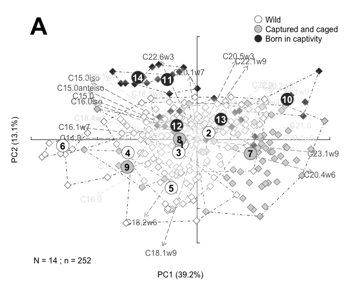

### Building the PLSDA

``` r
# Transforming group into indicating variable
var.ind <- DUMMY(paste(FA$Group, sep=""))
fac <- as.factor(paste(FA$Group, sep=""))

# Put the matrix into the good "matrix" shaping
DATA.M <- as.matrix(prct)

# Canonical Powered Partial least squared (PLS) regression
PLSDA <- cppls(var.ind ~ DATA.M, ncomp=2, scale=T) 
summary (PLSDA)
```

    ## Data:    X dimension: 252 28 
    ##  Y dimension: 252 3
    ## Fit method: cppls
    ## Number of components considered: 2
    ## TRAINING: % variance explained
    ##              1 comps  2 comps
    ## X          1.243e+01    44.60
    ## BornCap    5.632e+01    56.47
    ## Cap&Caged  6.482e-04    33.24
    ## Wild       2.741e+01    51.16

``` r
attributes(PLSDA)
```

    ## $names
    ##  [1] "coefficients"           "scores"                 "loadings"              
    ##  [4] "loading.weights"        "Yscores"                "Yloadings"             
    ##  [7] "projection"             "Xmeans"                 "Ymeans"                
    ## [10] "fitted.values"          "residuals"              "Xvar"                  
    ## [13] "Xtotvar"                "gammas"                 "canonical.correlations"
    ## [16] "smallNorm"              "A"                      "trunc.pow"             
    ## [19] "fit.time"               "ncomp"                  "method"                
    ## [22] "center"                 "scale"                  "call"                  
    ## [25] "terms"                  "model"                 
    ## 
    ## $class
    ## [1] "mvr"

``` r
PLSDA$scores
```

    ##           Comp 1       Comp 2
    ## 1   -0.120398314 -0.302002430
    ## 2   -0.506366351  1.040157021
    ## 3    0.642770802  0.847529854
    ## 4    0.310808908 -0.049022464
    ## 5   -0.479023262 -1.045701166
    ## 6    0.817693607  0.942582424
    ## 7   -0.299049121 -1.336979213
    ## 8   -0.653754737 -2.534433663
    ## 9    0.268673117  1.102332427
    ## 10   0.219380286  1.168008688
    ## 11   0.256552621 -0.099702936
    ## 12   0.498488427  0.160604406
    ## 13   0.362072152  1.250543902
    ## 14  -0.155465203 -0.346904630
    ## 15   0.169341975  0.521991034
    ## 16  -0.242478937  0.749308763
    ## 17   0.205690323 -0.729822979
    ## 18   0.198764168  0.622202319
    ## 19  -0.250249291 -2.165935564
    ## 20  -1.053374696 -2.769852350
    ## 21  -0.334255180 -3.141313130
    ## 22  -0.754573421 -1.815651739
    ## 23   0.428324793 -2.030715675
    ## 24  -0.857606010 -2.625714930
    ## 25   0.141164992 -2.298661775
    ## 26   0.248531244 -2.504950137
    ## 27  -1.339376305 -0.403510617
    ## 28  -0.325693652  1.068789574
    ## 29  -0.832711793  1.526597595
    ## 30  -0.965716096  2.246108056
    ## 31  -0.033857427 -0.684806403
    ## 32  -0.589389044 -1.345877058
    ## 33  -0.907132310  0.432089707
    ## 34  -0.918769762 -1.878454362
    ## 35  -1.143397868  0.437489252
    ## 36  -0.973708178 -1.405922014
    ## 37  -0.999375210  2.254803343
    ## 38  -0.560182607 -0.812106675
    ## 39  -1.557929232 -1.539625974
    ## 40  -1.672235628  0.204676734
    ## 41  -2.671884933  1.257680190
    ## 42  -2.089949747  0.571683500
    ## 43  -1.784301303  0.370100422
    ## 44  -1.393392144 -0.747678834
    ## 45  -0.211751046 -1.109639687
    ## 46  -1.167462516  1.083746105
    ## 47  -0.215947424 -2.442474022
    ## 48  -0.358516813 -2.088494099
    ## 49  -0.413647881 -2.760911602
    ## 50  -1.005966909 -4.128168659
    ## 51  -1.346416175 -1.759625982
    ## 52  -1.085560579 -2.746312248
    ## 53  -1.358554072 -3.363510453
    ## 54  -0.764324796 -4.339112209
    ## 55  -1.462435730 -2.438154163
    ## 56  -1.308799912 -1.610404984
    ## 57  -1.785302732 -0.503915881
    ## 58  -1.484102354 -2.297149738
    ## 59  -1.213550882 -0.937461538
    ## 60  -1.376837143 -2.503601899
    ## 61  -2.377925829  1.175618608
    ## 62  -1.594117968 -1.489748372
    ## 63  -1.552636366 -2.478538338
    ## 64  -1.049000934 -3.672649679
    ## 65  -1.685533065 -3.809338704
    ## 66  -1.429546049 -1.876823062
    ## 67  -1.996210370 -3.083413220
    ## 68  -0.127584941 -1.673798786
    ## 69  -0.159431203 -3.882268821
    ## 70   0.435649536 -1.006083240
    ## 71  -0.208724752 -2.875670441
    ## 72   0.886513622 -0.167347557
    ## 73   0.644337859 -0.710681831
    ## 74   0.166332188 -1.082728341
    ## 75  -0.166092680  0.245936684
    ## 76  -0.233145611 -0.728599104
    ## 77   0.067912913 -1.943589499
    ## 78  -0.447160364 -2.092444698
    ## 79  -0.057831100 -1.338275116
    ## 80   0.063194242 -2.303762681
    ## 81   0.550636840 -1.712582235
    ## 82  -1.649232387 -1.552726865
    ## 83   0.188434503 -1.306938217
    ## 84  -0.176033613 -1.750049596
    ## 85   0.066521351 -3.586316628
    ## 86   0.418311520 -0.938150584
    ## 87  -0.323665049 -2.867873551
    ## 88   0.239810608 -0.762664920
    ## 89  -0.530694265  0.177547997
    ## 90   0.396097205  0.424048721
    ## 91   0.198923851 -1.364257280
    ## 92   0.417094772 -0.202009456
    ## 93  -0.675502079 -2.243261220
    ## 94   0.755860328 -3.431747682
    ## 95   1.107123434 -0.605220002
    ## 96   0.248614142 -0.746195901
    ## 97  -0.615148718 -1.339039852
    ## 98   0.622610865 -1.818241920
    ## 99   0.949163840  0.886714114
    ## 100 -0.090710091 -0.061263228
    ## 101 -0.025318226  0.777271961
    ## 102  0.072384585  0.965484380
    ## 103  0.180371453  0.002977224
    ## 104  0.166265952 -0.897256367
    ## 105  0.108028763  1.106159320
    ## 106 -1.867791405 -0.212940692
    ## 107 -0.015278325 -0.729530342
    ## 108 -0.584490622  0.617944862
    ## 109 -1.235223942 -0.777250939
    ## 110 -0.622675600  2.933622811
    ## 111 -0.269560369 -1.563453598
    ## 112 -0.188603054  1.824832746
    ## 113 -0.492831848  0.007119199
    ## 114 -1.441458182  0.164797401
    ## 115 -2.234129588 -2.540230019
    ## 116 -1.981845316 -2.748211359
    ## 117 -1.657427331 -3.078819839
    ## 118 -2.131703059  0.198122301
    ## 119 -2.902226223  1.243323558
    ## 120 -1.275060842  1.260962665
    ## 121 -1.670732485 -0.926164840
    ## 122 -2.713377184 -0.004447964
    ## 123 -3.102241665 -4.130071016
    ## 124 -1.784015604 -4.860377737
    ## 125 -2.474895241 -2.691058586
    ## 126  2.011945492  1.928594090
    ## 127 -0.762315411 -2.985795739
    ## 128 -1.321644222  1.489739958
    ## 129 -1.818867843  3.003981037
    ## 130 -1.852170114 -0.294424265
    ## 131 -1.661157349  0.254831690
    ## 132 -2.115170468  0.087980716
    ## 133 -2.423687052 -1.641581568
    ## 134 -1.842320888  1.279454142
    ## 135 -1.681424801  1.000420039
    ## 136 -1.421331131  4.052956977
    ## 137 -2.709990950  1.091713076
    ## 138 -1.872380617 -1.583316816
    ## 139  0.222258333 -0.231804773
    ## 140 -0.819570188  0.038192477
    ## 141  0.087675961 -1.825494280
    ## 142  0.631594664 -1.433260153
    ## 143  0.501387425 -0.788887693
    ## 144 -0.305003462  1.155656028
    ## 145 -1.639003950  1.506790540
    ## 146 -2.003897875  1.174882072
    ## 147 -2.217776475  1.246709450
    ## 148 -1.712183056  1.407186430
    ## 149 -1.664973284 -0.457545976
    ## 150 -0.968850679  2.404972195
    ## 151 -1.601706541 -5.327989969
    ## 152 -1.121280529 -5.758007503
    ## 153 -0.987990620 -4.626496484
    ## 154 -1.303276031 -4.945993400
    ## 155 -1.347456015 -5.437220775
    ## 156 -0.717507586 -4.608048579
    ## 157 -0.405193012  0.676022340
    ## 158  0.169638304  2.894368290
    ## 159  0.026458320  2.801685355
    ## 160 -0.051436309  1.124951870
    ## 161  0.023301644  2.502028901
    ## 162 -0.082996089  1.728795501
    ## 163 -1.775914583  2.785669122
    ## 164  0.164153612  3.316761609
    ## 165  0.004257429  1.068488417
    ## 166  0.137018326  0.682532204
    ## 167  0.181695773  2.357257225
    ## 168  0.497320634  2.370775026
    ## 169 -0.295642468  0.695927293
    ## 170 -0.733786449  2.548430127
    ## 171 -0.009112861  2.637337671
    ## 172  0.585983627  1.653434511
    ## 173 -0.150006189  1.392711742
    ## 174  0.740806044  0.140561386
    ## 175  0.343222646  0.546054772
    ## 176  1.264779033  2.063629774
    ## 177  0.349392893 -1.870854523
    ## 178 -0.061869782  3.616457818
    ## 179 -1.017407713  5.049788426
    ## 180 -0.776512005  4.408584613
    ## 181 -1.554177482  5.205122692
    ## 182 -0.206773420  3.208018907
    ## 183 -0.700326291  5.065526960
    ## 184  0.337072290  2.845313167
    ## 185 -0.316848937  4.209741667
    ## 186  0.268659675  4.019720600
    ## 187  0.854767942  2.482568677
    ## 188 -0.664832431  4.778215494
    ## 189  0.080772988  3.211785616
    ## 190  0.303397656  3.284472258
    ## 191  0.824807454  2.941730851
    ## 192 -0.818970001  4.952324417
    ## 193  0.499490203  2.770409739
    ## 194  0.039888678  4.685649328
    ## 195 -1.156765027  3.969483927
    ## 196 -0.554727954  4.261803540
    ## 197 -1.216769168  3.834078885
    ## 198 -0.063266874  3.946621757
    ## 199 -1.372451912  4.323640909
    ## 200 -0.676850277  3.588249936
    ## 201  0.217971317  3.065881787
    ## 202  0.411393184  1.985313505
    ## 203 -0.092256084  3.605394429
    ## 204  0.331257544  3.719222021
    ## 205 -0.531018378  1.544720027
    ## 206  0.546983470  3.593094483
    ## 207 -0.453929647  3.967333907
    ## 208 -1.149989962  4.141987121
    ## 209 -0.158598577  4.681137350
    ## 210  2.463303557  1.650673203
    ## 211  1.209367045  3.505268560
    ## 212  0.454771086  0.609666628
    ## 213  1.702369455 -3.722315247
    ## 214  0.801892568 -2.074383736
    ## 215 -0.381396091  0.464441886
    ## 216  0.429994126 -0.949698033
    ## 217  0.110284074  0.128723378
    ## 218  0.821160410 -3.262808104
    ## 219  0.724552909 -1.335506038
    ## 220  2.930843416  3.187965380
    ## 221  1.820404316  3.582963697
    ## 222  2.485749107  1.238699848
    ## 223  4.486196370  2.943806092
    ## 224  3.152226968  2.644436987
    ## 225  5.950714239 -0.045182034
    ## 226  5.899890598 -2.335232625
    ## 227  7.837218942 -2.172231815
    ## 228  7.444086619 -2.482976968
    ## 229  7.146868309 -1.221481152
    ## 230  5.868752576 -0.926101832
    ## 231  8.079169723 -0.927010386
    ## 232  6.969904240 -2.441595026
    ## 233  1.531344838  1.296103680
    ## 234  2.081650569  0.070515584
    ## 235  2.429905041 -0.755637875
    ## 236  2.006905356 -0.539624673
    ## 237  1.893467286 -0.994792813
    ## 238  1.351768083 -0.064439203
    ## 239  1.795226713 -0.931731909
    ## 240  2.002988140  1.530636136
    ## 241  2.320322174  3.006632082
    ## 242  2.154947169  1.772420740
    ## 243  2.775013664  0.193606945
    ## 244  2.352337958  1.174198572
    ## 245  2.084107268 -0.897244740
    ## 246  1.833145159  3.160950393
    ## 247  1.981287008 -4.242227672
    ## 248  2.215130598 -3.205455384
    ## 249  2.990775635 -1.542363141
    ## 250  3.031842887 -2.030995619
    ## 251  1.909090198 -3.462117391
    ## 252  2.255570638 -2.419824806
    ## attr(,"class")
    ## [1] "scores"

``` r
att=attributes(loadings(PLSDA))$explvar

# Let's check the risk of model overfitting
mod <- opls(DATA.M, FA$Group, predI = 2, orthoI = 0, crossvalI = 7, permI = 1000, scaleC = "standard")
```

    ## PLS-DA
    ## 252 samples x 28 variables and 1 response
    ## standard scaling of predictors and response(s)
    ##       R2X(cum) R2Y(cum) Q2(cum) RMSEE pre ort  pR2Y   pQ2
    ## Total    0.498    0.449   0.441 0.319   2   0 0.001 0.001

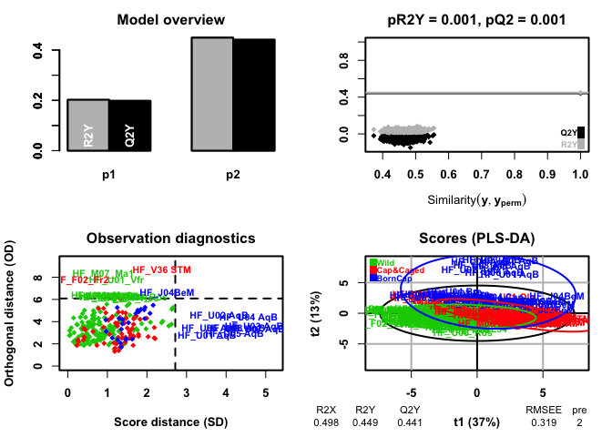

``` r
mod
```

    ## PLS-DA
    ## 252 samples x 28 variables and 1 response
    ## standard scaling of predictors and response(s)
    ##       R2X(cum) R2Y(cum) Q2(cum) RMSEE pre ort  pR2Y   pQ2
    ## Total    0.498    0.449   0.441 0.319   2   0 0.001 0.001

``` r
# Let's see which of the three groups are significantly different based on Euclidean distances between PLSDA coordinates

perm <- adonis2(prct~FA$Group, method="euclidean")

grp   <- factor(FA$Group)
pairs <- combn(levels(grp), 2, simplify = FALSE)

res <- do.call(rbind, lapply(pairs, function(p) {
  idx <- grp %in% p
  d   <- data.frame(g = droplevels(grp[idx]))
  a   <- adonis2(prct[idx, ] ~ g, data = d, method = "euclidean",
                 permutations = 9999)
  data.frame(pair = paste(p, collapse = " vs "),
             n    = sum(idx),
             F    = a$F[1],
             R2   = a$R2[1],
             p    = a$`Pr(>F)`[1])
}))
res$p_adj <- p.adjust(res$p, method = "holm")   # ou "BH"
res
```

    ##                   pair   n        F         R2     p p_adj
    ## 1 BornCap vs Cap&Caged  96 33.53082 0.26292329 1e-04 3e-04
    ## 2      BornCap vs Wild 189 15.74426 0.07765578 1e-04 3e-04
    ## 3    Cap&Caged vs Wild 219 50.73417 0.18949457 1e-04 3e-04

``` r
# Building a PLSDA model with only two modalities
var.ind <- DUMMY(paste(FA$Origin, sep=""))
fac <- as.factor(paste(FA$Origin, sep=""))

# Put the matrix into the good "matrix" shaping
DATA.M <- as.matrix(prct)

# Canonical Powered Partial least squared (PLS) regression
PLSDA <- cppls(var.ind ~ DATA.M, ncomp=2, scale=T) 
summary (PLSDA)
```

    ## Data:    X dimension: 252 28 
    ##  Y dimension: 252 2
    ## Fit method: cppls
    ## Number of components considered: 2
    ## TRAINING: % variance explained
    ##          1 comps  2 comps
    ## X          12.04    36.45
    ## BornCap    57.79    65.07
    ## BornW      57.79    65.07

``` r
attributes(PLSDA)
```

    ## $names
    ##  [1] "coefficients"           "scores"                 "loadings"              
    ##  [4] "loading.weights"        "Yscores"                "Yloadings"             
    ##  [7] "projection"             "Xmeans"                 "Ymeans"                
    ## [10] "fitted.values"          "residuals"              "Xvar"                  
    ## [13] "Xtotvar"                "gammas"                 "canonical.correlations"
    ## [16] "smallNorm"              "A"                      "trunc.pow"             
    ## [19] "fit.time"               "ncomp"                  "method"                
    ## [22] "center"                 "scale"                  "call"                  
    ## [25] "terms"                  "model"                 
    ## 
    ## $class
    ## [1] "mvr"

``` r
PLSDA$scores
```

    ##           Comp 1      Comp 2
    ## 1    0.122057359  0.58485795
    ## 2    0.675650193 -0.40078188
    ## 3   -0.362952321 -0.29109557
    ## 4   -0.181231567  0.20609206
    ## 5    0.365286098  0.76120083
    ## 6   -0.496904596 -0.68221588
    ## 7    0.125848032  0.71493248
    ## 8    0.421714332  2.56084611
    ## 9    0.059026586 -0.42167015
    ## 10   0.136416755 -0.46575224
    ## 11  -0.200558543  0.27556814
    ## 12  -0.351263750 -0.03975595
    ## 13  -0.101379801 -0.35630188
    ## 14   0.226729749  0.23636185
    ## 15   0.067019925 -0.17018527
    ## 16   0.488938461 -0.42612586
    ## 17  -0.213257678  0.42057056
    ## 18  -0.047414292 -0.39220952
    ## 19   0.024451122  0.96161438
    ## 20   0.755887614  1.81473082
    ## 21  -0.117563534  1.59516332
    ## 22   0.626716423  1.70374133
    ## 23  -0.675938823  0.18695016
    ## 24   0.461975636  1.01641088
    ## 25  -0.415739886  0.99298331
    ## 26  -0.502177639  2.04243599
    ## 27   1.120491798  0.13648591
    ## 28   0.534649460 -0.39983059
    ## 29   1.031696687 -0.72545962
    ## 30   1.118246668 -2.02142487
    ## 31  -0.007129846  0.09695038
    ## 32   0.326499179  1.22593182
    ## 33   0.802056535 -0.83648381
    ## 34   0.538145176  1.04678833
    ## 35   1.072791890 -1.09815830
    ## 36   0.830254766  0.79536460
    ## 37   1.099278224 -1.79094360
    ## 38   0.446410621  0.15958488
    ## 39   1.218638607  1.24294274
    ## 40   1.594174018  0.12569769
    ## 41   2.600776545 -0.94232817
    ## 42   1.989392017 -0.30607013
    ## 43   1.688018315 -0.26132924
    ## 44   1.270082474  0.54924480
    ## 45   0.070801857  0.51053729
    ## 46   1.193833634 -1.04699207
    ## 47  -0.110123518  1.18742552
    ## 48   0.107526635  1.48670697
    ## 49  -0.044372027  1.61679390
    ## 50   0.370625834  2.00709261
    ## 51   1.033353646  0.66307974
    ## 52   0.623324377  0.72605146
    ## 53   0.746680479  1.56460599
    ## 54   0.094852329  3.01427440
    ## 55   1.053211179  1.73211657
    ## 56   1.029705978  1.05496051
    ## 57   1.448600710 -0.60689336
    ## 58   0.991474745  0.81518516
    ## 59   1.025110100  0.29729575
    ## 60   0.989783782  1.46739097
    ## 61   2.484383076 -0.76221293
    ## 62   1.310091556  0.75661481
    ## 63   1.171899688  1.89339901
    ## 64   0.505954159  2.45883105
    ## 65   1.076126082  2.13842540
    ## 66   1.166235867  1.38005620
    ## 67   1.442970971  1.63869597
    ## 68  -0.093492719  0.83296992
    ## 69  -0.410552310  2.54135402
    ## 70  -0.504778861  0.50619937
    ## 71  -0.217770176  1.65904079
    ## 72  -0.792558901 -0.17647513
    ## 73  -0.588161141  0.65044390
    ## 74  -0.230812019  0.60092384
    ## 75   0.310519397 -0.01622210
    ## 76   0.236294399  0.38121397
    ## 77  -0.282833780  1.12415292
    ## 78   0.208432860  1.52746147
    ## 79  -0.031518140  0.82679094
    ## 80  -0.350544489  1.38810499
    ## 81  -0.728938434  0.97145660
    ## 82   1.270599468  0.18359116
    ## 83  -0.250771337  0.66052526
    ## 84   0.001075257  1.24784279
    ## 85  -0.530799620  2.32693050
    ## 86  -0.464052389  0.21446283
    ## 87  -0.046211554  1.82766277
    ## 88  -0.234209495  0.82001610
    ## 89   0.664237037 -0.61884772
    ## 90  -0.131144732  0.06454174
    ## 91  -0.368794803  0.72117993
    ## 92  -0.226523392  0.38705409
    ## 93   0.373163029  1.69880652
    ## 94  -1.171061253  1.99145781
    ## 95  -1.006333678  0.45425044
    ## 96  -0.144290720  0.71795887
    ## 97   0.549748846  1.32130599
    ## 98  -0.752506383  1.01753991
    ## 99  -0.604568263 -0.77241303
    ## 100  0.429129419  1.23217203
    ## 101  0.382631448 -0.12832411
    ## 102  0.217647236 -0.15105044
    ## 103 -0.029134295  0.11252165
    ## 104 -0.097589849  0.66759993
    ## 105  0.257465485 -0.37828931
    ## 106  1.770049091 -0.32855103
    ## 107  0.067809642  1.01948736
    ## 108  0.804302323  0.31873474
    ## 109  1.015781574  0.67472460
    ## 110  1.074368730 -1.28780465
    ## 111  0.080607344  1.24581247
    ## 112  0.521602357 -1.01401001
    ## 113  0.538840547  0.50549071
    ## 114  1.364314260  0.14243285
    ## 115  1.836119032  1.91965725
    ## 116  1.552950615  2.01642207
    ## 117  1.237980288  2.41187950
    ## 118  1.991324321 -0.84170970
    ## 119  2.854376915 -1.21023427
    ## 120  1.348958376 -1.22167438
    ## 121  1.598384546  0.43581933
    ## 122  2.679920277 -0.47406079
    ## 123  2.214815179  2.07751097
    ## 124  0.879229841  2.90995602
    ## 125  1.887407661  1.71923968
    ## 126 -1.791111466 -2.22150180
    ## 127  0.368033645  2.10776545
    ## 128  1.011922081 -2.54557254
    ## 129  2.004582382 -1.66084316
    ## 130  1.644681058 -0.17029614
    ## 131  1.590405528 -0.07561081
    ## 132  2.008362381 -0.19237731
    ## 133  1.996212416  1.06318291
    ## 134  1.880991035 -0.57441631
    ## 135  1.710320481 -0.90184005
    ## 136  1.838039633 -2.32492400
    ## 137  2.597847117 -1.21607092
    ## 138  1.535602005  0.68862153
    ## 139 -0.324484345  0.40381670
    ## 140  0.654022299 -0.19417463
    ## 141 -0.370968244  1.70231349
    ## 142 -0.936483918  0.59792515
    ## 143 -0.609436644  1.07812245
    ## 144  0.374524783 -0.16476718
    ## 145  1.638794019 -0.80351745
    ## 146  1.937790874 -0.42504541
    ## 147  2.117502929 -1.27861638
    ## 148  1.669118707 -0.75566526
    ## 149  1.518999911  0.46327796
    ## 150  1.107379074 -1.23112861
    ## 151  0.595064330  3.55640028
    ## 152  0.134768039  3.99771327
    ## 153  0.183955546  3.42654040
    ## 154  0.390546826  3.06372762
    ## 155  0.336175710  3.36899393
    ## 156 -0.053503432  2.85755345
    ## 157  0.465860130 -0.29810598
    ## 158  0.336463975 -1.32099307
    ## 159  0.429274333 -1.45522726
    ## 160  0.162799895 -0.68991666
    ## 161  0.483123394 -0.88147187
    ## 162  0.369323362 -0.80434570
    ## 163  1.952624137 -2.06506857
    ## 164  0.374405864 -1.83014909
    ## 165  0.099024050 -0.54766449
    ## 166  0.027530410  0.05102067
    ## 167  0.304655761 -0.34180477
    ## 168 -0.032313166 -1.04051190
    ## 169  0.438896596  0.13084298
    ## 170  1.074343300 -0.98528228
    ## 171  0.475554278 -0.95126129
    ## 172 -0.091779637 -0.80444111
    ## 173  0.568652619 -0.41456051
    ## 174 -0.513476976 -0.08594573
    ## 175 -0.024756610 -0.18550595
    ## 176 -0.759853866 -1.31183240
    ## 177 -0.521968277  0.87822091
    ## 178  0.680031829 -1.23726257
    ## 179  1.659509461 -2.47912066
    ## 180  1.546601625 -1.30246258
    ## 181  2.190349757 -2.33014282
    ## 182  0.822379788 -0.32618265
    ## 183  1.544478588 -1.66743762
    ## 184  0.229453066 -1.09704073
    ## 185  0.943715908 -1.52703854
    ## 186  0.234511403 -2.31004295
    ## 187 -0.373218691 -0.82292889
    ## 188  1.369621105 -1.77945194
    ## 189  0.345977916 -1.46555786
    ## 190  0.100955054 -1.57684696
    ## 191 -0.304222233 -1.07096326
    ## 192  1.403573802 -2.52679545
    ## 193  0.074059132 -0.47913070
    ## 194  0.831013887 -1.34175744
    ## 195  1.761336841 -1.34858665
    ## 196  1.154690907 -1.67317579
    ## 197  1.711248628 -1.21235379
    ## 198  0.794484667 -0.57300033
    ## 199  1.904323782 -1.96508838
    ## 200  1.201131104 -1.67641515
    ## 201  0.430304532 -0.72145558
    ## 202  0.023486111 -0.09720254
    ## 203  0.742497792 -1.10690945
    ## 204  0.165991242 -2.50125669
    ## 205  0.877971151  0.62295047
    ## 206  0.103619189 -1.71723115
    ## 207  1.146067819 -1.24033635
    ## 208  1.750597998 -1.51147681
    ## 209  1.083457604 -1.14312072
    ## 210 -2.247879663 -1.21384953
    ## 211 -0.823295530 -2.12960109
    ## 212 -0.377934864  0.15787102
    ## 213 -2.374233574  1.64030131
    ## 214 -1.223564732  1.57590522
    ## 215  0.268024699 -0.45096002
    ## 216 -0.745900308  0.85541325
    ## 217 -0.309368372  0.05652795
    ## 218 -1.462716492  2.36462023
    ## 219 -1.113029954  0.87546985
    ## 220 -2.320142685 -3.69181717
    ## 221 -1.168468722 -3.15248722
    ## 222 -2.284827369 -2.46774139
    ## 223 -3.844955871 -4.15568831
    ## 224 -2.645512819 -3.54890671
    ## 225 -5.861087394 -0.38379335
    ## 226 -6.215682474  1.13284558
    ## 227 -8.015198005  0.81561608
    ## 228 -7.721759198  0.80672099
    ## 229 -7.197771487  0.13283534
    ## 230 -5.936597645  0.42279464
    ## 231 -8.084393290 -0.22952795
    ## 232 -7.205681223  1.08745588
    ## 233 -1.420553190 -1.46553144
    ## 234 -2.176289014 -1.19017215
    ## 235 -2.622656699 -0.80860946
    ## 236 -2.205205048 -0.78582843
    ## 237 -2.144626034 -0.42668729
    ## 238 -1.483893137 -0.88146173
    ## 239 -2.055367709 -0.54217939
    ## 240 -1.751411633 -2.11682585
    ## 241 -1.883450687 -2.64243609
    ## 242 -1.886229189 -1.62671776
    ## 243 -2.703896572 -1.11866801
    ## 244 -2.115948995 -1.40932516
    ## 245 -2.223886967 -0.21073671
    ## 246 -1.388130396 -2.54322266
    ## 247 -2.688568774  0.95358801
    ## 248 -2.816987848  0.26398081
    ## 249 -3.273590474 -1.07032386
    ## 250 -3.393933938 -0.60405938
    ## 251 -2.542665588 -0.06669248
    ## 252 -2.716764428 -0.56265931
    ## attr(,"class")
    ## [1] "scores"

``` r
att=attributes(loadings(PLSDA))$explvar

# Let's check the risk of model overfitting
mod <- opls(DATA.M, FA$Origin, predI = 2, orthoI = 0, crossvalI = 7, permI = 1000, scaleC = "standard")
```

    ## PLS-DA
    ## 252 samples x 28 variables and 1 response
    ## standard scaling of predictors and response(s)
    ##       R2X(cum) R2Y(cum) Q2(cum) RMSEE pre ort  pR2Y   pQ2
    ## Total    0.365    0.651   0.636 0.201   2   0 0.001 0.001

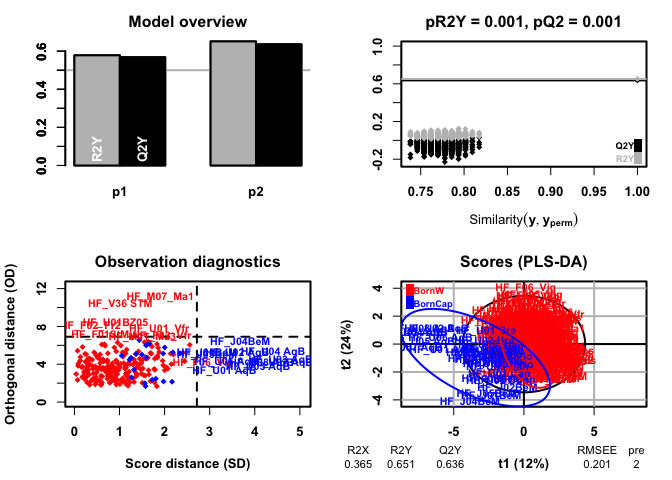

``` r
mod
```

    ## PLS-DA
    ## 252 samples x 28 variables and 1 response
    ## standard scaling of predictors and response(s)
    ##       R2X(cum) R2Y(cum) Q2(cum) RMSEE pre ort  pR2Y   pQ2
    ## Total    0.365    0.651   0.636 0.201   2   0 0.001 0.001

### Graphical representation using PLSDA

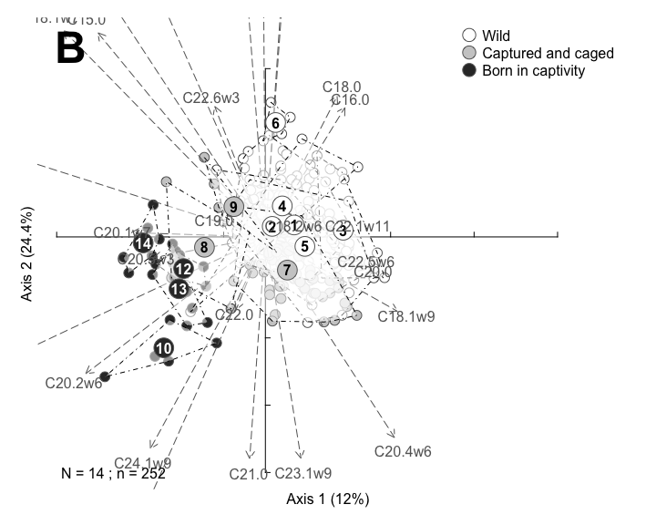

### Regression tree

``` r
# First version using all FA
xnam=paste0("prct$", colnames(prct))
fmla=as.formula(paste("FA$Origin ~ ", paste(xnam, collapse= "+")))

tree=rpart(fmla)

plot(tree)
text(tree)
```

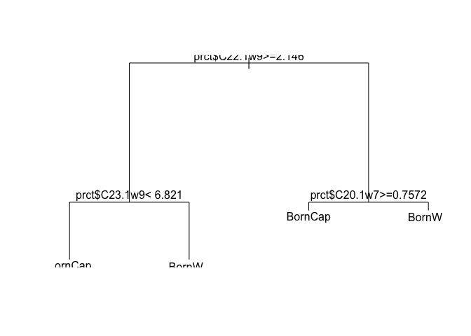

``` r
table(predict(tree, type="class"), FA$Origin)
```

    ##          
    ##           BornCap BornW
    ##   BornCap      30     5
    ##   BornW         3   214

``` r
# Second version using ratios
newTab=round(rowSums(prct[, c(which(colnames(prct)=="C20.1w9"), which(colnames(prct)=="C22.1w9"), which(colnames(prct)=="C24.1w9"))])/prct[, -c(which(colnames(prct)=="C20.1w9"), which(colnames(prct)=="C22.1w9"), which(colnames(prct)=="C24.1w9"))], 2)

xnam=paste0("newTab$", colnames(newTab))
fmla=as.formula(paste("FA$Origin ~ ", paste(xnam, collapse= "+")))

newTree=rpart(fmla)

plot(newTree)
text(newTree)
```

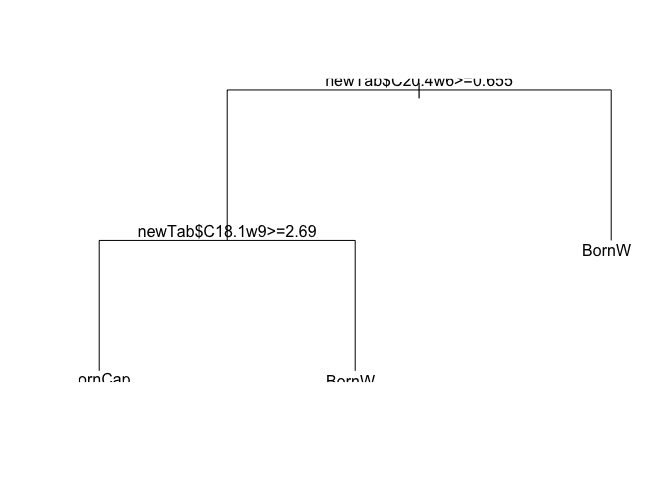

``` r
table(predict(newTree, type="class"), FA$Origin)
```

    ##          
    ##           BornCap BornW
    ##   BornCap      31     3
    ##   BornW         2   216

``` r
#Let's see which samples are wrongly classified
rownames(allFA[which(predict(newTree, type="class")!=FA$Origin),])
```

    ## [1] "HF_U01_Vfr" "HF_V36 STM" "HF_U01 Ole" "HF_J02BeM"  "HF_U01 Plo"

``` r
#Cross validation accuracy rate
AccuracyFA=1-newTree$cptable[3, "xerror"]*newTree$frame$dev[1]/newTree$frame$n[1]
print(AccuracyFA)
```

    ## [1] 0.952381

``` r
#Model validation
printcp(newTree) / plotcp(newTree)
```

    ## 
    ## Classification tree:
    ## rpart(formula = fmla)
    ## 
    ## Variables actually used in tree construction:
    ## [1] newTab$C18.1w9 newTab$C20.4w6
    ## 
    ## Root node error: 33/252 = 0.13095
    ## 
    ## n= 252 
    ## 
    ##        CP nsplit rel error  xerror    xstd
    ## 1 0.45455      0   1.00000 1.00000 0.16228
    ## 2 0.39394      1   0.54545 0.93939 0.15800
    ## 3 0.01000      2   0.15152 0.36364 0.10244

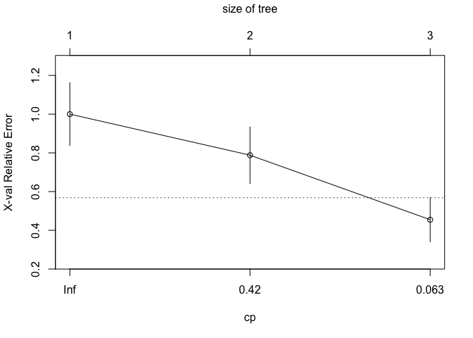

    ## numeric(0)

### Seasonal dynamics

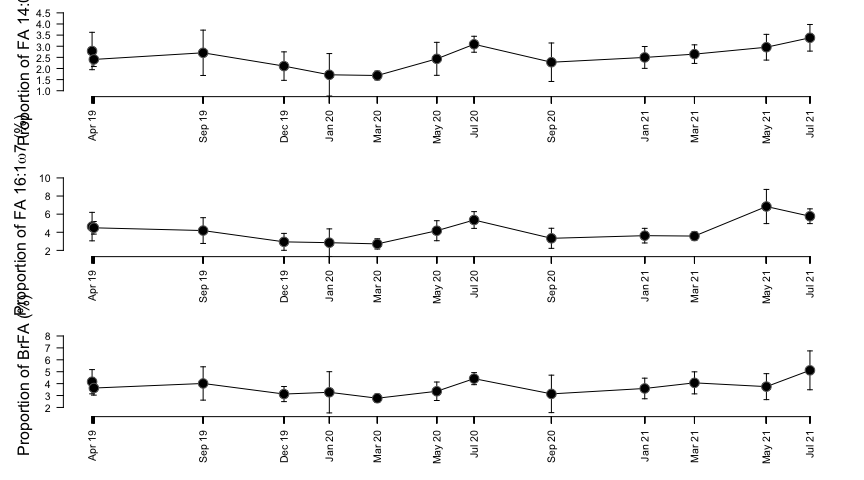

### Relationship between FA indicators and wild individuals size

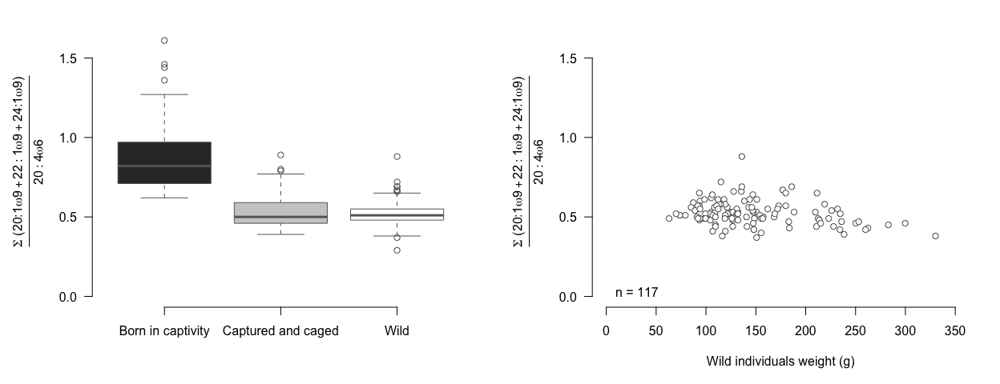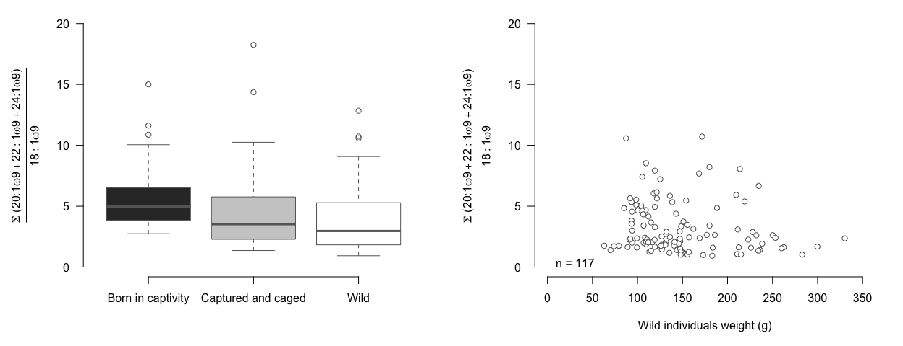

Stable isotopes
---------------

### Graphical representation (biplot 13C-15N)

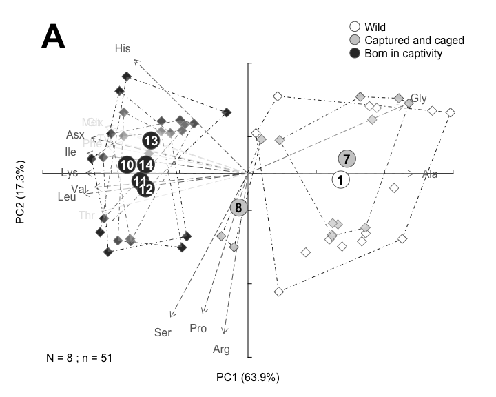

Amino acids
-----------

``` r
allAA=AA[,-c(1:6)]
rownames(allAA)=AA[,1]

# Let's edit a summary table

summaryAA=data.frame(M=aggregate(allAA , by=list(AA$SplBatch), mean), SD=aggregate(allAA, by=list(AA$SplBatch), sd), LE=aggregate(allAA, by=list(AA$SplBatch), length))

#write.table(t(summaryAA), file="meansAA.txt")
```

### Graphical representation using PCA


### Building the PLSDA

``` r
# Transforming group into indicating variable
var.ind <- DUMMY(paste(AA$Group, sep=""))
fac <- as.factor(paste(AA$Group, sep=""))

# Put the matrix into the good "matrix" shaping
DATA.M <- as.matrix(allAA)

# Canonical Powered Partial least squared (PLS) regression
PLSDA<-cppls(var.ind ~ DATA.M, ncomp=2, scale=T) 
summary (PLSDA)
```

    ## Data:    X dimension: 51 16 
    ##  Y dimension: 51 3
    ## Fit method: cppls
    ## Number of components considered: 2
    ## TRAINING: % variance explained
    ##            1 comps  2 comps
    ## X            63.51    68.03
    ## BornCap      80.84    82.37
    ## Cap&Caged    14.40    29.62
    ## Wild         39.89    45.08

``` r
attributes(PLSDA)
```

    ## $names
    ##  [1] "coefficients"           "scores"                 "loadings"              
    ##  [4] "loading.weights"        "Yscores"                "Yloadings"             
    ##  [7] "projection"             "Xmeans"                 "Ymeans"                
    ## [10] "fitted.values"          "residuals"              "Xvar"                  
    ## [13] "Xtotvar"                "gammas"                 "canonical.correlations"
    ## [16] "smallNorm"              "A"                      "trunc.pow"             
    ## [19] "fit.time"               "ncomp"                  "method"                
    ## [22] "center"                 "scale"                  "call"                  
    ## [25] "terms"                  "model"                 
    ## 
    ## $class
    ## [1] "mvr"

``` r
PLSDA$coefficients
```

    ## , , 1 comps
    ## 
    ##         BornCap    Cap&Caged         Wild
    ## Asx  0.04075168 -0.014618488 -0.026133192
    ## Thr  0.03624181 -0.013000703 -0.023241108
    ## Ser  0.02008410 -0.007204589 -0.012879507
    ## Glx  0.04595067 -0.016483474 -0.029467192
    ## Gly -0.03340958  0.011984723  0.021424861
    ## Ala -0.04152435  0.014895659  0.026628686
    ## Pro -0.00810268  0.002906603  0.005196078
    ## Val  0.03590044 -0.012878245 -0.023022192
    ## Met  0.03817366 -0.013693698 -0.024479962
    ## Ile  0.04639261 -0.016642008 -0.029750600
    ## Leu  0.04315959 -0.015482255 -0.027677332
    ## Tyr  0.03251201 -0.011662745 -0.020849267
    ## Phe  0.04193452 -0.015042796 -0.026891720
    ## His  0.02866155 -0.010281505 -0.018380050
    ## Lys  0.04412411 -0.015828249 -0.028295858
    ## Arg -0.01201899  0.004311466  0.007707525
    ## 
    ## , , 2 comps
    ## 
    ##         BornCap    Cap&Caged         Wild
    ## Asx  0.04983292 -0.038961685 -0.010871231
    ## Thr  0.01597689  0.041321538 -0.057298424
    ## Ser -0.02344888  0.109490085 -0.086041206
    ## Glx  0.02688648  0.034620052 -0.061506535
    ## Gly -0.04527300  0.043785849  0.001487152
    ## Ala -0.04697770  0.029513948  0.017463753
    ## Pro  0.03783028 -0.120221476  0.082391198
    ## Val  0.05276733 -0.058091707  0.005324378
    ## Met  0.04991800 -0.045175630 -0.004742372
    ## Ile  0.03619546  0.010692518 -0.046887975
    ## Leu  0.03633345  0.002815913 -0.039149363
    ## Tyr  0.03772389 -0.025633721 -0.012090167
    ## Phe  0.03214849  0.011189655 -0.043338149
    ## His  0.05251303 -0.074217864  0.021704836
    ## Lys  0.03875049 -0.001423700 -0.037326787
    ## Arg  0.01301352 -0.062790785  0.049777265

``` r
att=attributes(loadings(PLSDA))$explvar

# Let's check the risk of model overfitting
mod <- opls(DATA.M, AA$Group, predI = 2, orthoI = 0, crossvalI = 7, permI = 1000, scaleC = "standard")
```

    ## PLS-DA
    ## 51 samples x 16 variables and 1 response
    ## standard scaling of predictors and response(s)
    ##       R2X(cum) R2Y(cum) Q2(cum) RMSEE pre ort  pR2Y   pQ2
    ## Total    0.772    0.488   0.419 0.329   2   0 0.001 0.001

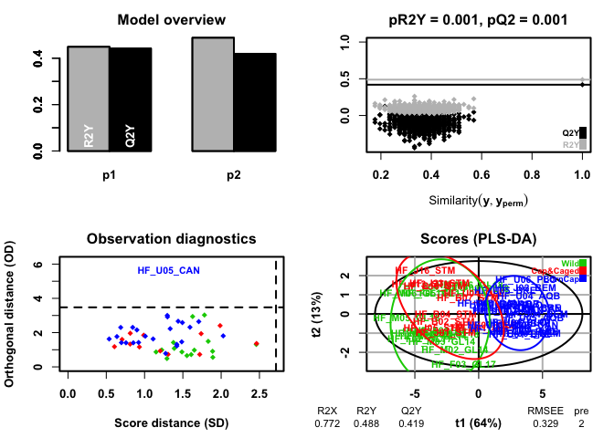

``` r
mod
```

    ## PLS-DA
    ## 51 samples x 16 variables and 1 response
    ## standard scaling of predictors and response(s)
    ##       R2X(cum) R2Y(cum) Q2(cum) RMSEE pre ort  pR2Y   pQ2
    ## Total    0.772    0.488   0.419 0.329   2   0 0.001 0.001

``` r
# Let's see which of the three groups are significantly different based on Euclidean distances between PLSDA coordinates

perm <- adonis2(allAA~AA$Group, method="euclidean")

grp   <- factor(AA$Group)
pairs <- combn(levels(grp), 2, simplify = FALSE)

res <- do.call(rbind, lapply(pairs, function(p) {
  idx <- grp %in% p
  d   <- data.frame(g = droplevels(grp[idx]))
  a   <- adonis2(allAA[idx, ] ~ g, data = d, method = "euclidean",
                 permutations = 9999)
  data.frame(pair = paste(p, collapse = " vs "),
             n    = sum(idx),
             F    = a$F[1],
             R2   = a$R2[1],
             p    = a$`Pr(>F)`[1])
}))
res$p_adj <- p.adjust(res$p, method = "holm")   # ou "BH"
res
```

    ##                   pair  n          F        R2      p  p_adj
    ## 1 BornCap vs Cap&Caged 36 39.5042833 0.5374419 0.0001 0.0003
    ## 2      BornCap vs Wild 39 51.6846374 0.5827913 0.0001 0.0003
    ## 3    Cap&Caged vs Wild 27  0.6063139 0.0236783 0.5088 0.5088

``` r
# Building a PLSDA model with only two modalities
var.ind <- DUMMY(paste(AA$Origin, sep=""))
fac <- as.factor(paste(AA$Origin, sep=""))

# Put the matrix into the good "matrix" shaping
DATA.M <- as.matrix(allAA)

# Canonical Powered Partial least squared (PLS) regression
PLSDA<-cppls(var.ind ~ DATA.M, ncomp=2, scale=T) 
summary (PLSDA)
```

    ## Data:    X dimension: 51 16 
    ##  Y dimension: 51 2
    ## Fit method: cppls
    ## Number of components considered: 2
    ## TRAINING: % variance explained
    ##          1 comps  2 comps
    ## X          63.78    80.60
    ## BornCap    81.00    82.94
    ## BornW      81.00    82.94

``` r
attributes(PLSDA)
```

    ## $names
    ##  [1] "coefficients"           "scores"                 "loadings"              
    ##  [4] "loading.weights"        "Yscores"                "Yloadings"             
    ##  [7] "projection"             "Xmeans"                 "Ymeans"                
    ## [10] "fitted.values"          "residuals"              "Xvar"                  
    ## [13] "Xtotvar"                "gammas"                 "canonical.correlations"
    ## [16] "smallNorm"              "A"                      "trunc.pow"             
    ## [19] "fit.time"               "ncomp"                  "method"                
    ## [22] "center"                 "scale"                  "call"                  
    ## [25] "terms"                  "model"                 
    ## 
    ## $class
    ## [1] "mvr"

``` r
PLSDA$coefficients
```

    ## , , 1 comps
    ## 
    ##           BornCap         BornW
    ## Asx  4.265546e-02 -4.265546e-02
    ## Thr  3.361387e-02 -3.361387e-02
    ## Ser  1.152587e-02 -1.152587e-02
    ## Glx  3.818164e-02 -3.818164e-02
    ## Gly -3.828529e-02  3.828529e-02
    ## Ala -4.317202e-02  4.317202e-02
    ## Pro  8.313201e-03 -8.313201e-03
    ## Val  4.062372e-02 -4.062372e-02
    ## Met  3.992103e-02 -3.992103e-02
    ## Ile  4.248034e-02 -4.248034e-02
    ## Leu  4.169343e-02 -4.169343e-02
    ## Tyr  3.419234e-02 -3.419234e-02
    ## Phe  3.782981e-02 -3.782981e-02
    ## His  3.418413e-02 -3.418413e-02
    ## Lys  4.223683e-02 -4.223683e-02
    ## Arg  9.073793e-05 -9.073793e-05
    ## 
    ## , , 2 comps
    ## 
    ##           BornCap         BornW
    ## Asx  0.0494162712 -0.0494162712
    ## Thr  0.0161354461 -0.0161354461
    ## Ser -0.0187412658  0.0187412658
    ## Glx  0.0449568420 -0.0449568420
    ## Gly -0.0325237871  0.0325237871
    ## Ala -0.0438469253  0.0438469253
    ## Pro -0.0004084145  0.0004084145
    ## Val  0.0442465729 -0.0442465729
    ## Met  0.0498612390 -0.0498612390
    ## Ile  0.0439782335 -0.0439782335
    ## Leu  0.0382438535 -0.0382438535
    ## Tyr  0.0348615047 -0.0348615047
    ## Phe  0.0412064240 -0.0412064240
    ## His  0.0488659781 -0.0488659781
    ## Lys  0.0428166498 -0.0428166498
    ## Arg -0.0192488306  0.0192488306

``` r
att=attributes(loadings(PLSDA))$explvar

# Let's check the risk of model overfitting
mod <- opls(DATA.M, AA$Origin, predI = 2, orthoI = 0, crossvalI = 7, permI = 1000, scaleC = "standard")
```

    ## PLS-DA
    ## 51 samples x 16 variables and 1 response
    ## standard scaling of predictors and response(s)
    ##       R2X(cum) R2Y(cum) Q2(cum) RMSEE pre ort  pR2Y   pQ2
    ## Total    0.806    0.829   0.812 0.213   2   0 0.001 0.001

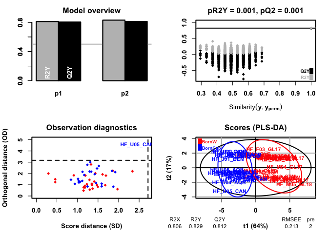

``` r
mod
```

    ## PLS-DA
    ## 51 samples x 16 variables and 1 response
    ## standard scaling of predictors and response(s)
    ##       R2X(cum) R2Y(cum) Q2(cum) RMSEE pre ort  pR2Y   pQ2
    ## Total    0.806    0.829   0.812 0.213   2   0 0.001 0.001

### Graphical representation using PLSDA

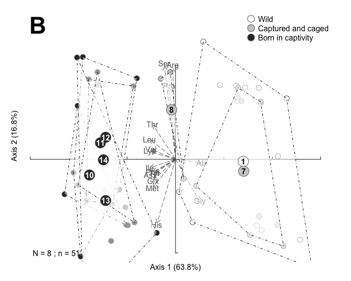

### Regression tree

``` r
# First version using all AA
xnam=paste0("allAA$", colnames(allAA))
fmla=as.formula(paste("AA$Origin ~ ", paste(xnam, collapse= "+")))

tree=rpart(fmla)

plot(tree)
text(tree)
```


``` r
table(predict(tree, type="class"), AA$Origin)
```

    ##          
    ##           BornCap BornW
    ##   BornCap      24     1
    ##   BornW         0    26

``` r
# Second version using ratios
newTab=round(allAA[, which(colnames(allAA)=="Asx")]/allAA[, -which(colnames(allAA)=="Asx")], 2)

xnam=paste0("newTab$", colnames(newTab))
fmla=as.formula(paste("AA$Origin ~ ", paste(xnam, collapse= "+")))

newTree=rpart(fmla)

plot(newTree)
text(newTree)
```

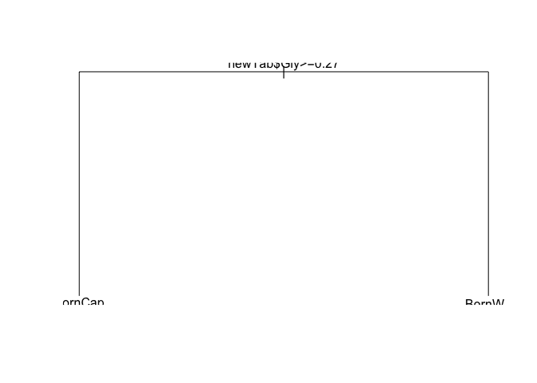

``` r
table(predict(newTree, type="class"), AA$Origin)
```

    ##          
    ##           BornCap BornW
    ##   BornCap      24     2
    ##   BornW         0    25

``` r
#Let's see which samples are wrongly classified
rownames(allAA[which(predict(newTree, type="class")!=AA$Origin),])
```

    ## [1] "HF_U01_OLE" "HF_U03_OLE"

``` r
#Cross validation accuracy rate
AccuracyAA=1-newTree$cptable[2, "xerror"]*newTree$frame$dev[1]/newTree$frame$n[1]
print(AccuracyAA)
```

    ## [1] 0.8823529

``` r
#Model validation
printcp(newTree) / plotcp(newTree)
```

    ## 
    ## Classification tree:
    ## rpart(formula = fmla)
    ## 
    ## Variables actually used in tree construction:
    ## [1] newTab$Gly
    ## 
    ## Root node error: 24/51 = 0.47059
    ## 
    ## n= 51 
    ## 
    ##        CP nsplit rel error xerror     xstd
    ## 1 0.91667      0  1.000000 1.4583 0.138069
    ## 2 0.01000      1  0.083333 0.2500 0.095871

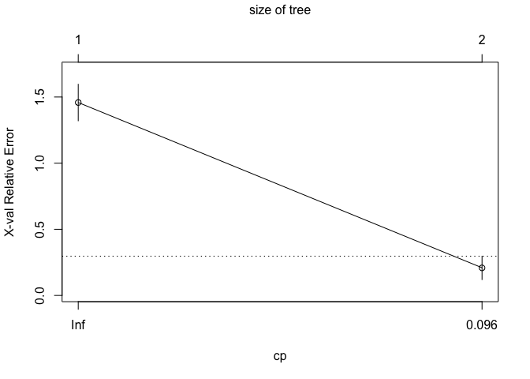

    ## numeric(0)

### Relationship between the AA indicator and wild individuals size

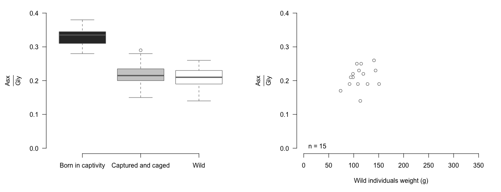

Sterols
-------

``` r
allSt=St[,-c(1:7, which(colnames(St)=="Stigmasterol"))]
rownames(allSt)=St[,1]
allSt[is.na(allSt)]=0

## Percentage table
prctSt=allSt/rowSums(allSt)*100

## Concentrations table 
concSt=allSt/St[,which(colnames(St)=="Stigmasterol")]*St[,which(colnames(St)=="StdStig")]/St[,which(colnames(St)=="SplMass")]
conctotSt=rowSums(concSt)

# Let's edit a summary table

summarySt=data.frame(M=aggregate(cbind(prctSt, conctotSt) , by=list(St$SplBatch), mean), SD=aggregate(cbind(prctSt, conctotSt), by=list(St$SplBatch), sd), LE=aggregate(cbind(prctSt, conctotSt), by=list(St$SplBatch), length))

#write.table(t(summarySt), file="meansSt.txt")
```

### Graphical representation using PCA

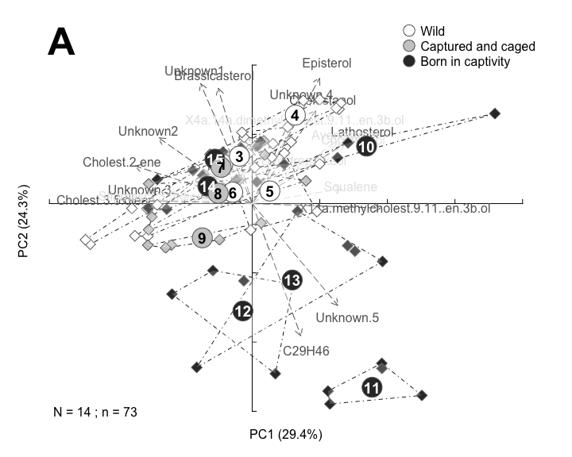

### Building the PLSDA

``` r
# Transforming group into indicating variable
var.ind <- DUMMY(paste(St$Group, sep=""))
fac <- as.factor(paste(St$Group, sep=""))

# Put the matrix into the good "matrix" shaping
DATA.M <- as.matrix(prctSt)

# Canonical Powered Partial least squared (PLS) regression
PLSDA<-cppls(var.ind ~ DATA.M, ncomp=2, scale=T)
summary (PLSDA)
```

    ## Data:    X dimension: 73 19 
    ##  Y dimension: 73 3
    ## Fit method: cppls
    ## Number of components considered: 2
    ## TRAINING: % variance explained
    ##            1 comps  2 comps
    ## X            22.19    36.93
    ## BornCap      48.75    54.52
    ## Cap&Caged    10.86    26.43
    ## Wild         19.53    19.98

``` r
attributes(PLSDA)
```

    ## $names
    ##  [1] "coefficients"           "scores"                 "loadings"              
    ##  [4] "loading.weights"        "Yscores"                "Yloadings"             
    ##  [7] "projection"             "Xmeans"                 "Ymeans"                
    ## [10] "fitted.values"          "residuals"              "Xvar"                  
    ## [13] "Xtotvar"                "gammas"                 "canonical.correlations"
    ## [16] "smallNorm"              "A"                      "trunc.pow"             
    ## [19] "fit.time"               "ncomp"                  "method"                
    ## [22] "center"                 "scale"                  "call"                  
    ## [25] "terms"                  "model"                 
    ## 
    ## $class
    ## [1] "mvr"

``` r
PLSDA$coefficients
```

    ## , , 1 comps
    ## 
    ##                                             BornCap    Cap&Caged         Wild
    ## Squalene                               -0.021419344  0.007861359  0.013557986
    ## Unknown1                               -0.022570260  0.008283769  0.014286491
    ## Cholest.2.ene                          -0.054150616  0.019874437  0.034276179
    ## Unknown2                               -0.028235963  0.010363204  0.017872759
    ## Cholest.3.5.diene                      -0.039986161  0.014675778  0.025310382
    ## Brassicasterol                         -0.015960590  0.005857879  0.010102712
    ## Unknown.3                              -0.006148411  0.002256599  0.003891812
    ## Stigmasta.3.5.diene                    -0.080520918  0.029552903  0.050968015
    ## C29H46                                  0.075131335 -0.027574810 -0.047556524
    ## Cholesterol                             0.018373893 -0.006743612 -0.011630280
    ## Cholestanol                            -0.026152316  0.009598461  0.016553856
    ## Unknown.4                              -0.038726900  0.014213603  0.024513298
    ## X14a.methylcholest.9.11..en.3b.ol       0.055774611 -0.020470478 -0.035304133
    ## Lathosterol                             0.003209804 -0.001178067 -0.002031737
    ## Episterol                              -0.010873551  0.003990826  0.006882725
    ## X4a.14a.dimethylcholest.9.11..en.3b.ol -0.039228333  0.014397639  0.024830694
    ## Dihydroparkeol                          0.048452840 -0.017783231 -0.030669609
    ## Avenesterol                            -0.027736197  0.010179779  0.017556418
    ## Unknown.5                               0.067642758 -0.024826342 -0.042816416
    ## 
    ## , , 2 comps
    ## 
    ##                                              BornCap    Cap&Caged         Wild
    ## Squalene                               -0.0470133331  0.040554098  0.006459235
    ## Unknown1                                0.0109325254 -0.034511351  0.023578826
    ## Cholest.2.ene                          -0.0618497471  0.029709000  0.032140747
    ## Unknown2                               -0.0073797446 -0.016277697  0.023657442
    ## Cholest.3.5.diene                      -0.0405740744  0.015426756  0.025147319
    ## Brassicasterol                          0.0047629233 -0.020613510  0.015850587
    ## Unknown.3                               0.0078908526 -0.015676596  0.007785744
    ## Stigmasta.3.5.diene                    -0.1203394531  0.080415510  0.039923943
    ## C29H46                                  0.0773354719 -0.030390287 -0.046945185
    ## Cholesterol                             0.0220591933 -0.011451068 -0.010608125
    ## Cholestanol                            -0.0161219740 -0.003213898  0.019335872
    ## Unknown.4                              -0.0339247727  0.008079557  0.025845216
    ## X14a.methylcholest.9.11..en.3b.ol       0.0636453245 -0.030524213 -0.033121112
    ## Lathosterol                             0.0006146279  0.002136908 -0.002751536
    ## Episterol                               0.0107116851 -0.023581293  0.012869608
    ## X4a.14a.dimethylcholest.9.11..en.3b.ol -0.0501781390  0.028384484  0.021793655
    ## Dihydroparkeol                          0.0746845468 -0.051290566 -0.023393981
    ## Avenesterol                            -0.0431680041  0.029891753  0.013276251
    ## Unknown.5                               0.0659049783 -0.022606572 -0.043298407

``` r
att=attributes(loadings(PLSDA))$explvar

# Let's check the risk of model overfitting
mod <- opls(DATA.M, St$Group, predI = 2, orthoI = 0, crossvalI = 7, permI = 1000, scaleC = "standard")
```

    ## PLS-DA
    ## 73 samples x 19 variables and 1 response
    ## standard scaling of predictors and response(s)
    ##       R2X(cum) R2Y(cum) Q2(cum) RMSEE pre ort  pR2Y   pQ2
    ## Total    0.454    0.328   0.236 0.379   2   0 0.001 0.001

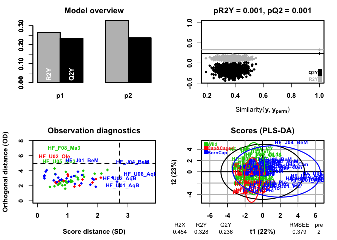

``` r
mod
```

    ## PLS-DA
    ## 73 samples x 19 variables and 1 response
    ## standard scaling of predictors and response(s)
    ##       R2X(cum) R2Y(cum) Q2(cum) RMSEE pre ort  pR2Y   pQ2
    ## Total    0.454    0.328   0.236 0.379   2   0 0.001 0.001

``` r
# Let's see which of the three groups are significantly different based on Euclidean distances between PLSDA coordinates

perm <- adonis2(prctSt~St$Group, method="euclidean")

grp   <- factor(St$Group)
pairs <- combn(levels(grp), 2, simplify = FALSE)

res <- do.call(rbind, lapply(pairs, function(p) {
  idx <- grp %in% p
  d   <- data.frame(g = droplevels(grp[idx]))
  a   <- adonis2(prctSt[idx, ] ~ g, data = d, method = "euclidean",
                 permutations = 9999)
  data.frame(pair = paste(p, collapse = " vs "),
             n    = sum(idx),
             F    = a$F[1],
             R2   = a$R2[1],
             p    = a$`Pr(>F)`[1])
}))
res$p_adj <- p.adjust(res$p, method = "holm")   # ou "BH"
res
```

    ##                   pair  n         F         R2      p  p_adj
    ## 1 BornCap vs Cap&Caged 43  8.566008 0.17282021 0.0014 0.0028
    ## 2      BornCap vs Wild 60 13.308339 0.18663090 0.0001 0.0003
    ## 3    Cap&Caged vs Wild 43  3.644796 0.08163989 0.0038 0.0038

``` r
# Building a PLSDA model with only two modalities
var.ind <- DUMMY(paste(St$Origin, sep=""))
fac <- as.factor(paste(St$Origin, sep=""))

# Put the matrix into the good "matrix" shaping
DATA.M <- as.matrix(prctSt)

# Canonical Powered Partial least squared (PLS) regression
PLSDA<-cppls(var.ind ~ DATA.M, ncomp=2, scale=T)
summary (PLSDA)
```

    ## Data:    X dimension: 73 19 
    ##  Y dimension: 73 2
    ## Fit method: cppls
    ## Number of components considered: 2
    ## TRAINING: % variance explained
    ##          1 comps  2 comps
    ## X          22.07    37.61
    ## BornCap    48.86    61.66
    ## BornW      48.86    61.66

``` r
attributes(PLSDA)
```

    ## $names
    ##  [1] "coefficients"           "scores"                 "loadings"              
    ##  [4] "loading.weights"        "Yscores"                "Yloadings"             
    ##  [7] "projection"             "Xmeans"                 "Ymeans"                
    ## [10] "fitted.values"          "residuals"              "Xvar"                  
    ## [13] "Xtotvar"                "gammas"                 "canonical.correlations"
    ## [16] "smallNorm"              "A"                      "trunc.pow"             
    ## [19] "fit.time"               "ncomp"                  "method"                
    ## [22] "center"                 "scale"                  "call"                  
    ## [25] "terms"                  "model"                 
    ## 
    ## $class
    ## [1] "mvr"

``` r
PLSDA$coefficients
```

    ## , , 1 comps
    ## 
    ##                                             BornCap        BornW
    ## Squalene                               -0.020837256  0.020837256
    ## Unknown1                               -0.025680732  0.025680732
    ## Cholest.2.ene                          -0.052550187  0.052550187
    ## Unknown2                               -0.029090059  0.029090059
    ## Cholest.3.5.diene                      -0.037773761  0.037773761
    ## Brassicasterol                         -0.018161826  0.018161826
    ## Unknown.3                              -0.005539031  0.005539031
    ## Stigmasta.3.5.diene                    -0.077830851  0.077830851
    ## C29H46                                  0.075665378 -0.075665378
    ## Cholesterol                             0.018161863 -0.018161863
    ## Cholestanol                            -0.030040655  0.030040655
    ## Unknown.4                              -0.041989436  0.041989436
    ## X14a.methylcholest.9.11..en.3b.ol       0.054492613 -0.054492613
    ## Lathosterol                             0.002661427 -0.002661427
    ## Episterol                              -0.014634178  0.014634178
    ## X4a.14a.dimethylcholest.9.11..en.3b.ol -0.040335125  0.040335125
    ## Dihydroparkeol                          0.047687262 -0.047687262
    ## Avenesterol                            -0.028541038  0.028541038
    ## Unknown.5                               0.067927082 -0.067927082
    ## 
    ## , , 2 comps
    ## 
    ##                                             BornCap        BornW
    ## Squalene                               -0.064675839  0.064675839
    ## Unknown1                                0.004796004 -0.004796004
    ## Cholest.2.ene                          -0.048568177  0.048568177
    ## Unknown2                                0.002849336 -0.002849336
    ## Cholest.3.5.diene                      -0.012399848  0.012399848
    ## Brassicasterol                         -0.001952873  0.001952873
    ## Unknown.3                               0.029938291 -0.029938291
    ## Stigmasta.3.5.diene                    -0.125738792  0.125738792
    ## C29H46                                  0.084723738 -0.084723738
    ## Cholesterol                             0.025461791 -0.025461791
    ## Cholestanol                            -0.057291511  0.057291511
    ## Unknown.4                              -0.071381744  0.071381744
    ## X14a.methylcholest.9.11..en.3b.ol       0.055557322 -0.055557322
    ## Lathosterol                            -0.006589960  0.006589960
    ## Episterol                              -0.014990076  0.014990076
    ## X4a.14a.dimethylcholest.9.11..en.3b.ol -0.075129404  0.075129404
    ## Dihydroparkeol                          0.093813788 -0.093813788
    ## Avenesterol                            -0.068390889  0.068390889
    ## Unknown.5                               0.066865351 -0.066865351

``` r
att=attributes(loadings(PLSDA))$explvar

# Let's check the risk of model overfitting
mod <- opls(DATA.M, St$Origin, predI = 2, orthoI = 0, crossvalI = 7, permI = 1000, scaleC = "standard")
```

    ## PLS-DA
    ## 73 samples x 19 variables and 1 response
    ## standard scaling of predictors and response(s)
    ##       R2X(cum) R2Y(cum) Q2(cum) RMSEE pre ort  pR2Y   pQ2
    ## Total    0.376    0.617   0.531 0.311   2   0 0.001 0.001

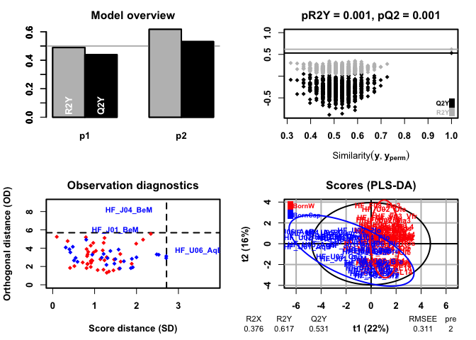

``` r
mod
```

    ## PLS-DA
    ## 73 samples x 19 variables and 1 response
    ## standard scaling of predictors and response(s)
    ##       R2X(cum) R2Y(cum) Q2(cum) RMSEE pre ort  pR2Y   pQ2
    ## Total    0.376    0.617   0.531 0.311   2   0 0.001 0.001

### Graphical representation using PLSDA

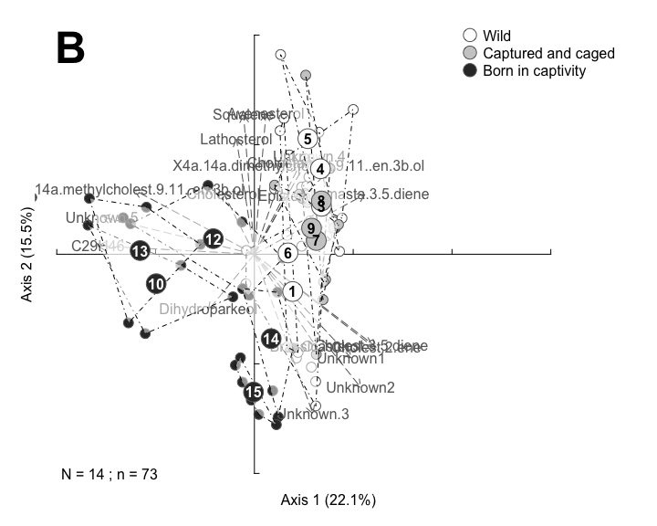

### Regression tree

``` r
# First version using all sterols
xnam=paste0("prctSt$", colnames(prctSt))
fmla=as.formula(paste("St$Origin ~ ", paste(xnam, collapse= "+")))

tree=rpart(fmla)

plot(tree)
text(tree)
```

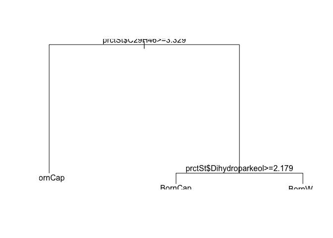

``` r
table(predict(tree, type="class"), St$Origin)
```

    ##          
    ##           BornCap BornW
    ##   BornCap      30     4
    ##   BornW         0    39

``` r
# Second version using ratios
newTab=round(prctSt[, which(colnames(prctSt)=="C29H46")]/prctSt[, -which(colnames(prctSt)=="C29H46")], 2)

xnam=paste0("newTab$", colnames(newTab))
fmla=as.formula(paste("St$Origin ~ ", paste(xnam, collapse= "+")))

newTree=rpart(fmla)

plot(newTree)
text(newTree)
```

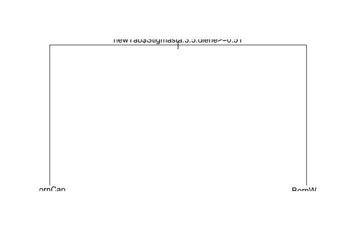

``` r
table(predict(newTree, type="class"), St$Origin)
```

    ##          
    ##           BornCap BornW
    ##   BornCap      26     0
    ##   BornW         4    43

``` r
#Let's see which samples are wrongly classified
rownames(allSt[which(predict(newTree, type="class")!=St$Origin),])
```

    ## [1] "HF_J01_BeM" "HF_J03_BeM" "HF_J05_BeM" "HF_U06_Plo"

``` r
#Cross validation accuracy rate
AccuracySt=1-newTree$cptable[2, "xerror"]*newTree$frame$dev[1]/newTree$frame$n[1]
print(AccuracySt)
```

    ## [1] 0.9315068

``` r
#Model validation
printcp(newTree) / plotcp(newTree)
```

    ## 
    ## Classification tree:
    ## rpart(formula = fmla)
    ## 
    ## Variables actually used in tree construction:
    ## [1] newTab$Stigmasta.3.5.diene
    ## 
    ## Root node error: 30/73 = 0.41096
    ## 
    ## n= 73 
    ## 
    ##        CP nsplit rel error  xerror     xstd
    ## 1 0.86667      0   1.00000 1.00000 0.140124
    ## 2 0.01000      1   0.13333 0.16667 0.071938

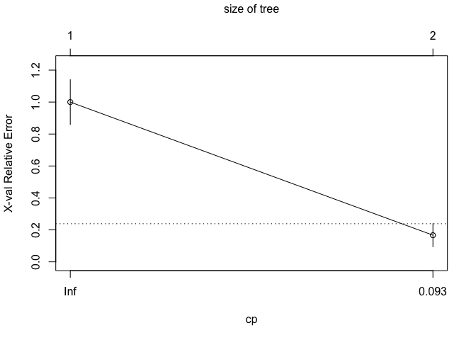

    ## numeric(0)

### Relationship between the St indicator and wild individuals size

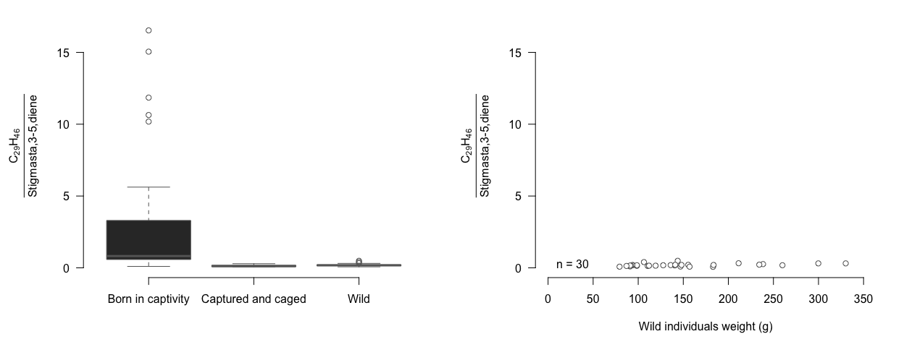
